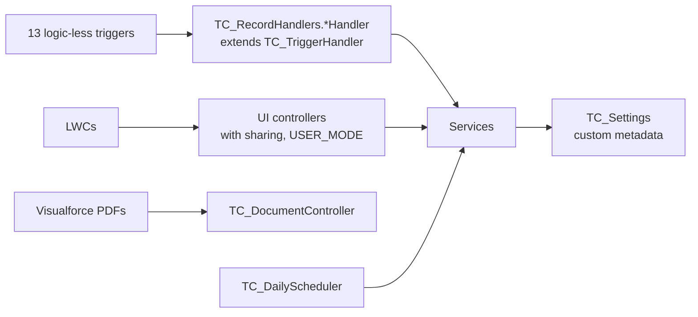

# Apex Implementation — TC Commercial Real Estate

The Apex layer is 26 classes (8 of them test classes) and 13 triggers, all on
API 64.0.

## Architecture

### Conventions

- **One trigger per object, with no logic.** Each trigger is a single line,
  for example `new TC_RecordHandlers.TC_DealHandler().run();`.
- **`TC_TriggerHandler`** routes the trigger context and checks two kinds of
  bypass:
  - the `TC_Bypass_Settings__c.TC_Bypass_Triggers__c` hierarchy setting
    (org, profile or user level);
  - a programmatic per-handler bypass.

  It also provides the helpers `changed()` and `idsOf()`.
- **Services are bulk-safe.** Collections go in, there is no SOQL or DML inside
  loops, and static flags stop the services re-entering themselves:
  - `TC_CommissionService.running`
  - `TC_DealService.closing`
  - `TC_LeaseService.suppressRentTableGeneration`
- **Sharing:**
  - Services are `inherited sharing`.
  - UI controllers are `with sharing`, query `WITH USER_MODE` and write with
    `AccessLevel.USER_MODE`.
  - `TC_PropertyRollupService` is deliberately `without sharing`. An aggregate
    has to count every child record, and it writes only Apex-maintained,
    read-only fields.
- **No hard-coded configuration.** Automation toggles, stage probabilities,
  field mappings and name formats come from custom metadata through
  `TC_Settings`, which tests can override.
- **Errors reach the UI in plain language.** Controllers convert exceptions to
  `AuraHandledException` with the DML message, and business-rule errors use
  `TC_Exception`.

## Classes

| Class | Responsibility |
|---|---|
| `TC_TriggerHandler` | Base handler: routing, bypass and helpers |
| `TC_RecordHandlers` | One inner handler per object: Property, Availability, Listing, Lease, Lease Period, Deal Period, Deal, Commission, Inquiry, Prospective Listing, Prospective Buyer, Term Sheet, Sale |
| `TC_Settings` | Cached metadata access: `isActive(setting, recordType)`, `stageProbability`, `orderedStages`, `fieldMappings(group)`, `nameMapping`, `stackingPlan`, record type helpers |
| `TC_FieldMappingService` | Object Field Mapping engine. Applies a mapping group (static or dynamic values, scoped by record type, optionally to blank target fields only), and coerces static values to the target field type. |
| `TC_NamingService` | Builds record names from `TC_Object_Name_Mapping__mdt` formats such as `{0} - {1} ({2} SF)`. Parent names are resolved in bulk. |
| `TC_RentTableService` | Builds rent schedules (period length, escalation, free rent carved out of the first period). Calculates each period with Annual Ratio Rent or Monthly Rate. Non-blocking review for gaps, overlaps and blank rent. Copies a deal's rent table to its lease. Estimates total rent for deals that have no periods. |
| `TC_DealService` | Defaults (lead broker, status, probability by stage, client field auto-population by record type). Gross deal value by business line and gross fee by method. Optional rule that inside brokers total 100% on Won. **Close Deal**: on Won, creates the Lease (plus rent table), Sale or Listing via the field mappings, closes the Availability, and never creates duplicates. |
| `TC_CommissionService` | Validation and defaults. Recalculation: co-broker and expense amounts come off the gross fee to give the net deal fee; inside brokers and analysts split the net; house share; deal totals. Status follows the deal outcome. Bulk rows (maximum 30). |
| `TC_LeaseService` | Landlord and unit defaults, overlap prevention, rent table generation, unit occupancy sync, daily status sweep |
| `TC_PropertyRollupService` | Property leased SF, available SF, average asking rate and active listings. Listing total available SF. Account portfolio SF. |
| `TC_InquiryService` | Prospective listing sync and single primary. Convert to Account, Contact and Deal (in a savepoint). Find Matches: a 0–100 score from listing type, property type, size, budget and location. |
| `TC_DailyScheduler` | Nightly job: lease status sweep and contact follow-up sequences (30-60-90 days, monthly, quarterly) |
| `TC_PropertyUIController` | Property summary, stacking plan model, property search (filters plus `DISTANCE()` radius) and the brokerage dashboard aggregates |
| `TC_DealUIController` | Pipeline, stage update, Close Deal information and action, rent table, commission grid (runs the `TC_Commission_Trigger` flow hook), term sheets, scorecards, commission dashboard |
| `TC_RecordUIController` | Convert-inquiry information and action, find and save matches, image gallery, relationship grid, PDF generation (allow-listed page names) |
| `TC_DocumentController` | Visualforce controller for the property flyer, lease comp report and tour book |
| `TC_Exception` | User-safe business exception |
| `TC_TestDataFactory` | Test data builders, plus a Broker user for permission tests |

## Key calculations

**Gross deal value**

| Deal type | Value used |
|---|---|
| Lease (Tenant, Landlord or Lease Administration) | Sum of the Deal Period total rent, or the estimated escalated rent over the term |
| Sale (Buyer, Seller or Listing Pursuit) | Sale price, or listing price if there is no sale price |
| Financing (Capital Markets or Financing) | Loan amount |
| Other | Actual value |

**Gross fee**

| Method | Calculation |
|---|---|
| Percent | Value × % |
| By $ per SF | Size × rate per SF (Tenant and Landlord Representation only, enforced by a validation rule) |
| Amount | Entered by the user |

**Period rent**
- Rent per month = rate × size ÷ 12.
- Annual Ratio Rent total = (days in period ÷ days in year) × rent per month × 12.
- Monthly Rate total = duration in months × rent per month.
- Free rent periods total 0.

**Commission split**
- Net deal fee = gross fee − co-broker − expense.
- Inside broker or analyst gross = net deal fee × fee % (or a fixed amount).
- House = inside broker gross × house %.
- Net commission (formula) = gross − house − direct expenses.

## Extending

- **Change behaviour without code:**
  - toggle `TC_Automation_Setting__mdt` records;
  - edit `TC_Object_Field_Mapping__mdt` to change what Close Deal copies;
  - edit `TC_Deal_Stage_Setting__mdt` to change stages and probabilities.
- **Add commission logic declaratively** in the `TC_Commission_Trigger` flow.
  It runs for every row saved from the commission grid.
- **Data loads:** turn on `TC_Bypass_Settings__c` for the integration user to
  skip triggers, validation rules and flows.
