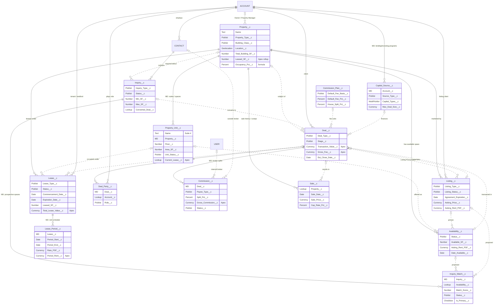
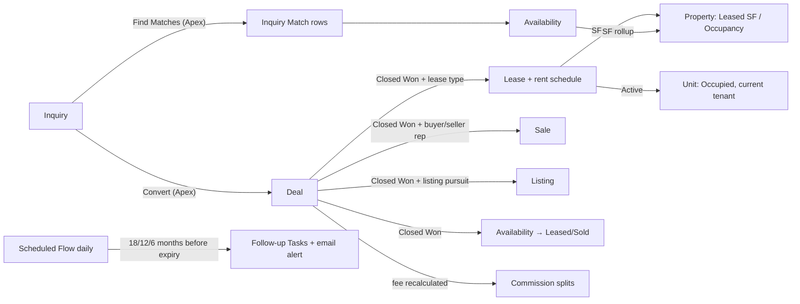

# Entity Relationship Diagram — REA Commercial Real Estate CRM

Status: **PROPOSED.** Field-level detail is in [Salesforce_Data_Model.md](Salesforce_Data_Model.md).

- **Solid lines (`||--o{`)**: the child can't exist without its parent
  (master-detail, or a required lookup).
- **Dotted lines (`|o..o{`)**: optional lookups.
- Standard objects are written in CAPS.

## Relationship summary

| Child | Parent | Type | Delete behaviour |
|---|---|---|---|
| Property_Unit__c | Property__c | Master-detail | Cascade |
| Deal_Party__c | Deal__c | Master-detail | Cascade |
| Commission__c | Deal__c | Master-detail | Cascade (the Closed Won lock stops accidental deletes) |
| Capital_Source__c | Account | Master-detail | Cascade |
| Lease_Period__c | Lease__c | Master-detail | Cascade |
| Inquiry_Match__c | Inquiry__c | Master-detail | Cascade |
| Sale__c | Property__c | Lookup (required) | Restrict |
| Listing__c, Availability__c, Lease__c | Property__c | Lookup (required) | Restrict delete: a property with leases or listings can't be deleted |
| Availability__c, Lease__c | Property_Unit__c | Lookup | Clear |
| Deal__c | Property / Listing / Availability / Inquiry / Capital Source / Commission Plan | Lookup | Clear |
| Lease__c | Deal__c | Lookup | Clear |
| Inquiry__c | Contact | Lookup (required) | Restrict |
| Deal__c, Listing__c, Lease__c | Account (client / tenant / landlord) | Lookup | Restrict on required lookups |

## Key automated data flows

