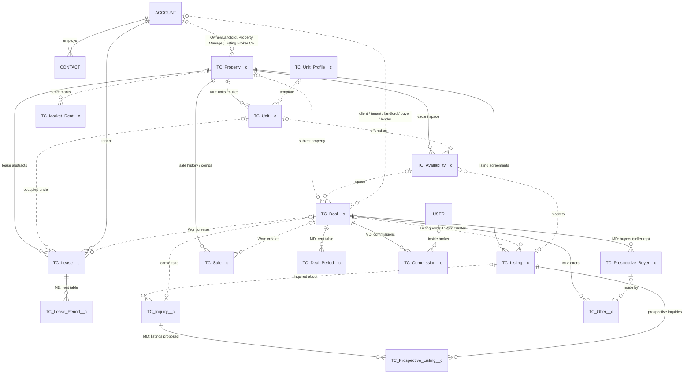
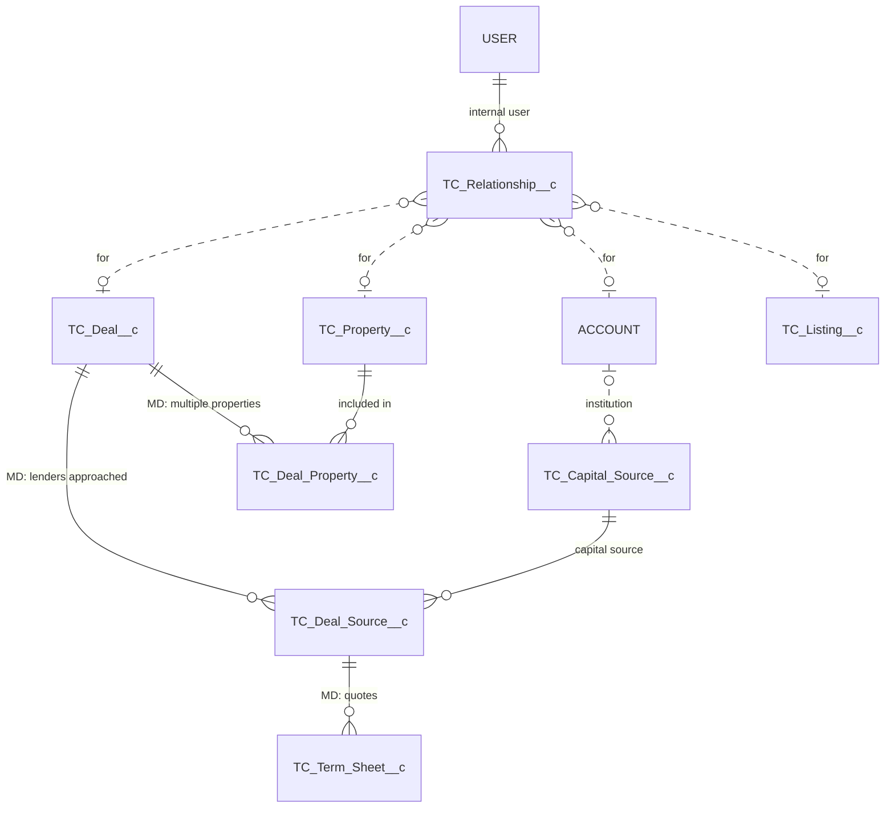
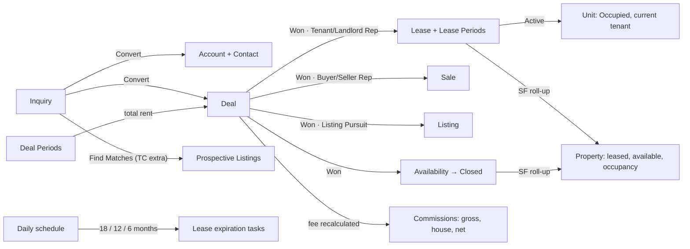

# Entity Relationship Diagram — TC Commercial Real Estate

This mirrors the AscendixRE object structure documented publicly. Field-level
detail is in [Salesforce_Data_Model.md](Salesforce_Data_Model.md).

How to read the diagram:
- **Solid lines** are master-detail relationships or required lookups.
- **Dotted lines** are optional lookups.
- Standard objects are in capitals.

## Core brokerage model

## Capital markets and relationships

## Relationship summary

| Child | Parent | Type | On parent delete |
|---|---|---|---|
| TC_Unit__c | TC_Property__c | Master-detail | Cascade |
| TC_Deal_Period__c, TC_Commission__c, TC_Prospective_Buyer__c, TC_Offer__c, TC_Deal_Source__c, TC_Deal_Property__c | TC_Deal__c | Master-detail | Cascade |
| TC_Lease_Period__c | TC_Lease__c | Master-detail | Cascade |
| TC_Prospective_Listing__c | TC_Inquiry__c | Master-detail | Cascade |
| TC_Term_Sheet__c | TC_Deal_Source__c | Master-detail | Cascade |
| TC_Availability__c, TC_Listing__c, TC_Lease__c, TC_Sale__c | TC_Property__c | Required lookup | Delete blocked |
| TC_Lease__c | Account (Tenant) | Required lookup | Delete blocked |
| TC_Prospective_Listing__c | TC_Listing__c | Required lookup | Delete blocked |
| TC_Deal_Source__c | TC_Capital_Source__c | Required lookup | Delete blocked |
| All other lookups | – | Optional lookup | Field cleared |

## Automated data flows

The field mappings used on deal close are records of
`TC_Object_Field_Mapping__mdt`, in the groups `DEAL_TO_LEASE`, `DEAL_TO_SALE`,
`DEAL_TO_LISTING`, `DEAL_TO_AVAILABILITY` and `PROPERTY_TO_LISTING`. An admin
can change them without editing code.
